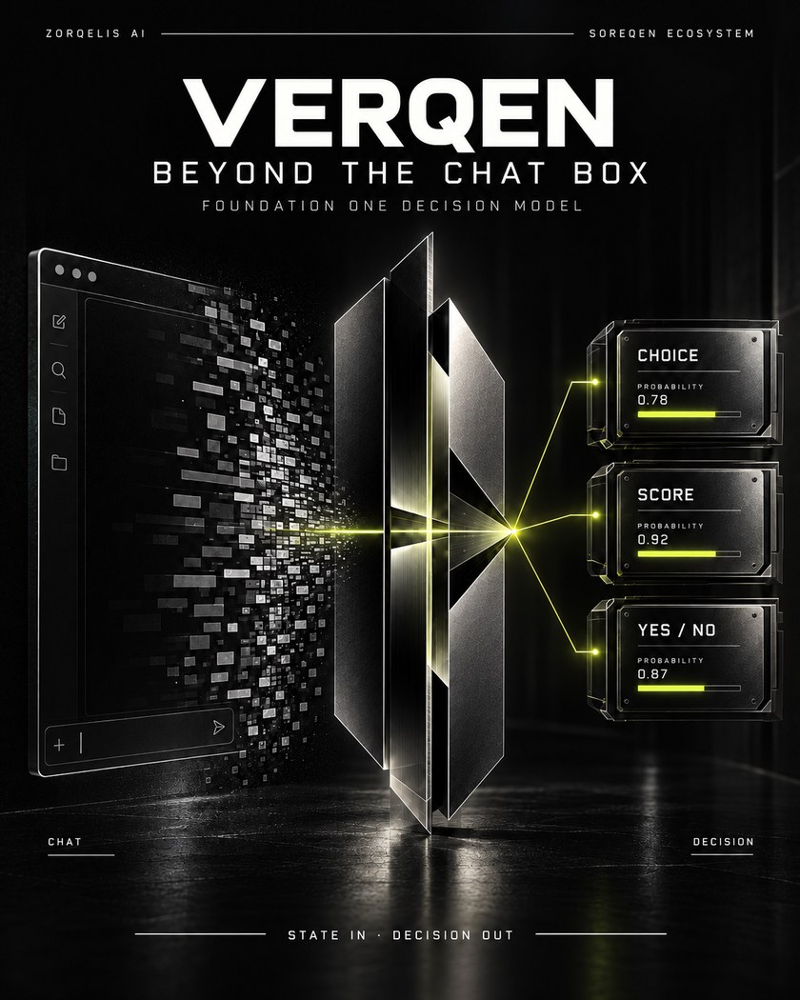

<div align="center">



# VerQen

**Beyond the chat box. An open decision model that applies your rules in about 5 milliseconds.**<br>
State in, decision out: one option, a calibrated probability, and a flag for when to hand over.

[](LICENSE)
[](https://huggingface.co/zorqelis-ai/VerQen)
[](https://huggingface.co/datasets/zorqelis-ai/zds-1)
[](https://huggingface.co/datasets/zorqelis-ai/verqen-decisions)

[What it is](#what-it-is) · [Quickstart](#quickstart) · [Results](#results-on-zds-1) · [Where to use it](#where-to-use-it) · [How it was built](#how-it-was-built) · [Reproduce](#reproduce-it) · [Website](https://zorqelisai.com/blog)

</div>

---

## What it is

Most AI products put a chat box in front of a language model. Many decisions a product makes all day do not need a conversation: route this ticket, approve this refund, is this message a prompt injection, which tool should the agent call next. They need **one answer from a fixed set, fast, with an honest confidence**.

VerQen is built for that job and nothing else. It reads a *state* (the policy and the case), a question and a list of options, and returns a typed decision. It never writes free text, so it never rambles, and it tells you when it is not sure enough to act.

<picture>
  <source media="(prefers-color-scheme: dark)" srcset="assets/how-it-works-dark.svg">
  
</picture>

| | |
|---|---|
| **Model** | 232.2M-parameter encoder, trained from scratch by ZorQelis AI |
| **Latency** | 4.7 to 7.3 ms p50 on an RTX 5060 Ti; 2.8 ms on an RTX 5090 |
| **Cost** | $1.7 to $4.0 per million decisions on a cloud L4-class GPU |
| **Output** | `choice`, `noul` (yes or no) or `score`, with probabilities, a conformal prediction set and `should_escalate` |
| **Context** | 2,048 tokens, English |
| **Licence** | Apache 2.0, weights and code |

## Quickstart

```bash
pip install git+https://github.com/ZorQelis-AI/verqen
```

```python
from verqen import Verqen

vq = Verqen.from_pretrained("zorqelis-ai/VerQen", risk="0.05")   # downloads once, runs locally on GPU or CPU
r = vq.decide(
    state="Refund policy: refunds are allowed within 30 days of delivery for unused items.\n"
          "Case: The item was delivered 45 days ago and is unused.",
    question="Should the refund be approved?",
    options=["approve_refund", "deny_refund", "escalate_to_agent"],
)
print(r["selected"], r["p_correct"], r["should_escalate"])   # deny_refund 0.6656 True
```

`risk="0.05"` asks VerQen to act alone only where its calibrated error rate stays under 5%. Here it chose correctly but was not certain enough, so it raised `should_escalate`. Act on the confident decisions and route the rest to a person or a larger model.

<details>
<summary><b>More of the API</b></summary>

```python
# yes or no, with p_true
vq.decide(state=..., question="Is the account verified?", question_type="noul")

# several questions about one state, state encoded once
vq.decide_multi(state, [{"type": "choice", "text": "Which team?", "options": ["billing", "tech"]},
                        {"type": "noul", "text": "Is it urgent?"}])

# batches: thousands of decisions a second on one GPU
vq.decide_many([{"state": s, "questions": [{"type": "choice", "text": q, "options": opts}]} for s in states])

# certify the risk on every calibration group, not just on average (high stakes)
Verqen.from_pretrained("zorqelis-ai/VerQen", risk="0.02", risk_mode="worst_group")
```

Every decision returns `selected`, `probabilities` (per option), `p_correct` (calibrated), `margin`, `prediction_set` (conformal) and `should_escalate`.

</details>

## Results on ZDS-1

We scored VerQen, Laya and Jev on the **ZorQelis Decision Suite (ZDS-1)**: 22,864 cases in three tracks, one harness, identical inputs for every system. Jev is TypeSafe's `jev-1.13`, called through OpenRouter's Decisions API; Laya is Convai's open model, run on the same GPU as VerQen.

<picture>
  <source media="(prefers-color-scheme: dark)" srcset="assets/zds1-dark.svg">
  
</picture>

| | ZDS-1 | Jev-parity | Laya-parity | AGY-32 | p50 latency | $ / 1M |
|---|---:|---:|---:|---:|---:|---:|
| Jev 1.13 (API) | **78.4** | 60.6 | **77.9** | **96.9** | 409 to 443 ms | 15 to 29 |
| **VerQen** | 73.9 | **93.7** | 75.9 | 52.0 | **4.7 to 7.3 ms** | **1.7 to 4.0** |
| Laya | 52.6 | 19.3 | 63.1 | 75.5 | 26 to 58 ms | 6 to 13 |

**No model wins everything, and we publish the tracks we lose.**

- **Where VerQen leads: rules written in the input.** 93.7% on Jev-parity, 33 points ahead of Jev. It asks for more information when a fact is missing (99.6%) or two sources conflict (100%), where Jev scores 0.7% and 7.3%. It resists prompt injection (93.0% vs 53.2%).
- **Close on real classification.** 75.9% on Laya-parity, 2 points behind Jev, with the best calibration of the three (ECE 0.039). Best on banking77 (85.5%) and emotion (91.5%).
- **Where it trails: judgement from world knowledge, with no rules.** 52.0% on AGY-32, last of the three. VerQen learned its language from 7B tokens; this is the next thing we are working on.
- **Fair-play notes.** Jev-parity is VerQen's home ground (ZorQelis AI built it). VerQen saw the train splits of six Laya-parity datasets, never their test splits. Details in the [ZDS-1 card](https://huggingface.co/datasets/zorqelis-ai/zds-1).

<picture>
  <source media="(prefers-color-scheme: dark)" srcset="assets/speed-cost-dark.svg">
  
</picture>

Score any model on ZDS-1:

```bash
git clone https://huggingface.co/datasets/zorqelis-ai/zds-1 && cd zds-1
python harness/zds1.py --adapter verqen --checkpoint zorqelis-ai/VerQen --out-dir results/verqen
OPENROUTER_API_KEY=... python harness/zds1.py --adapter jev_openrouter --model typesafe/jev-1.13 --out-dir results/jev
```

## Where to use it

| Use VerQen for | Look elsewhere for |
|---|---|
| Policy and eligibility checks: refunds, returns, KYC, claims, access | Judgement that rests on broad world knowledge with no rules given |
| Routing tickets, intents and queues (77-way banking77: 85.5%) | Languages other than English |
| Agent guardrails: which tool, is it in scope, is it an injection, when to stop | Generating text |
| Triage at volume, escalating the uncertain cases instead of guessing | High-stakes medical, legal or financial calls without human review |

## How it was built

VerQen was trained from scratch on two NVIDIA RTX 5090 GPUs in about 23 hours. Every stage below is in this repository.

| Stage | What happened |
|---|---|
| **1. Pretraining** | Masked-language modelling on a curated 4.07B-token corpus (FineWeb-Edu, Cosmopedia v2, FineMath 4+, Wikipedia, synthetic text): 7.05B tokens, then context extension to 2,048. MLM beat replaced-token detection in a pre-registered A/B (0.622 vs 0.431). |
| **2. Decision training** | 1.51M typed decisions: 105 procedural specifications across 22 business domains, multi-step environments and 33 public datasets. |
| **3. RLCD** | Reinforcement Learning from Calibrated Decisions: exact expected reward over the option set, a proper scoring rule to keep probabilities honest, and group-relative policy gradients on multi-step environments. |
| **4. Top-up** | Oracle trajectories with deliberate detours, 32 phrasings of missing and conflicting facts, cases buried in long unrelated text, extra rehearsal of real datasets; blended with the earlier weights (WiSE-FT) so no domain regressed. |
| **5. Format diversity** | Real tasks rewritten in many layouts so VerQen learns the task, not the template: XNLI 40.7% to 68.6%, banking77 65.9% to 85.5% in unseen layouts. |
| **6. Calibration** | Temperature scaling, conformal prediction sets, per-group risk control. |

**Every stage had to earn its release.** A candidate replaced the previous model only if it passed a rule fixed before its results were seen: no more than 0.5 points lost overall and no more than 3 points in any domain or question type, on the validation split. Twice a candidate with large gains failed that rule; the fixes that got them through are written up in [`docs/production/NEXT_RUN.md`](docs/production/NEXT_RUN.md), along with the bugs we found along the way.

## Reproduce it

```bash
pip install -e ".[dev]" && pytest -q                  # 35 tests
python scripts/v3/build_data.py --out data/decision/v3 # the same 1.51M decisions (seeded)
bash production/run_all.sh                             # pretrain, decisions, RLCD, release selection (2 GPUs)
bash production/agentic_topup.sh                       # the top-up stage
```

The full runbook for a rented two-GPU machine is [`docs/production/RUNBOOK.md`](docs/production/RUNBOOK.md) and the reasoning behind every choice is in [`docs/production/T2_PLAN.md`](docs/production/T2_PLAN.md). VerQen was developed under the working name VerQen-T2, which the configs and docs still use.

| Path | What is there |
|---|---|
| `verqen/` | The model, tokenizer, training loops, RLCD, calibration and inference engine |
| `verqen/data/v3/` | The decision engine: 105 specifications, verification, held-out phrasings |
| `scripts/v3/` | Data building, trajectories, paraphrase / long-context / format augmentation, stage runner, WiSE merge |
| `production/` | Box setup, preflight, the staged pipeline, release selection, finalization |
| `evals/` | Jev-parity and Laya-parity builders, the harness (local and API), paired comparison, AGY-32 cases |
| `docs/` | Runbook, plan, engineering reports, lessons for the next run |

## Open data

| | |
|---|---|
| [zorqelis-ai/VerQen](https://huggingface.co/zorqelis-ai/VerQen) | Weights, tokenizer, calibration, model card |
| [zorqelis-ai/verqen-decisions](https://huggingface.co/datasets/zorqelis-ai/verqen-decisions) | 1.62M training decisions in 5 configs, licence on every row |
| [zorqelis-ai/zds-1](https://huggingface.co/datasets/zorqelis-ai/zds-1) | ZorQelis Decision Suite: cases, harness and every result file |

## Citation

```bibtex
@misc{verqen2026,
  title  = {VerQen: an open decision model},
  author = {{ZorQelis AI}},
  year   = {2026},
  url    = {https://github.com/ZorQelis-AI/verqen}
}
```

Code and weights are released under the [Apache 2.0 licence](LICENSE). Built by [ZorQelis AI](https://zorqelisai.com) in New Delhi, India.
